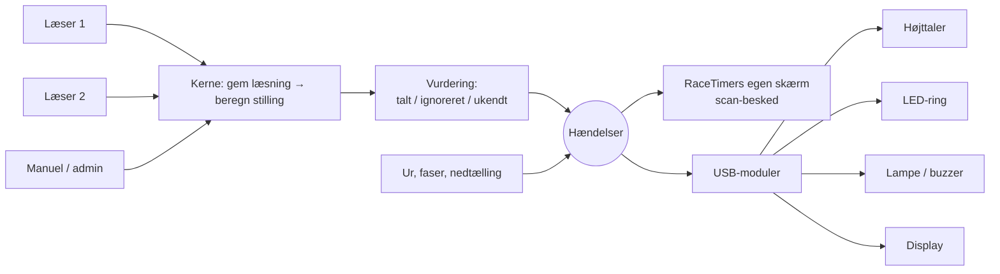

# Udkast: modulsystem til RaceTimer

> **Status:** fase 1 er bygget: hændelser, vurdering, fanen *Moduler*, USB-højttaler og skærmens scan-besked. Fase 2–3 (Pico-enheder) er stadig udkast.

## Formål

Hver klub skal kunne **tilslutte eksterne enheder via USB** efter behov, fx en LED-ring ved læseren, en højttaler, en signallampe eller et display, **uden at ændre i tidtagningen**. Er der ikke tilsluttet noget, kører RaceTimer præcis som i dag.

Et modul er altså altid en **fysisk enhed på USB**. Ting, der kun vises på skærmen, er en del af RaceTimer selv og ikke et modul.

## Grundprincipper

1. **Tidtagningen er hellig.** En læsning gemmes i databasen, *før* noget modul hører om den. Et modul kan aldrig forsinke, ændre eller miste en læsning.
2. **Moduler lytter, de bestemmer ikke.** De får besked om hændelser og reagerer med lys eller lyd. De kan ikke ændre resultater.
3. **Fejl er isolerede.** Trækkes et kabel ud, eller går en enhed ned, vises det i admin. Enheden forbindes automatisk igen, og alt andet kører videre.
4. **Sæt i og brug.** Enheder findes automatisk på USB. Alt sættes op i admin med en **Test**-knap. Man skal aldrig redigere filer på Pi'en.
5. **Kun signeret kode på Pi'en.** Understøttelsen af enheder følger med i de signerede udgivelser. Vil man bygge sin egen enhed, taler den et åbent USB-protokol. Man lægger ikke kode ind på Pi'en.
6. **Kun lokalt.** Moduler kører på Pi'en ved stævnet, ikke på spejlserveren eller hjemmesiden.

## Overblik



Den nye del i kernen er **vurderingen**. I dag ved RaceTimer først, om en læsning tæller, når stillingen beregnes. Vurderingen sammenligner løberen før og efter læsningen og fortæller *hvad* der skete og *hvorfor*. Både modulerne og skærmens scan-besked bygger på den.

## Hvornår læses chips

Chips læses kun to steder, og begge sender hændelser:

| Situation | Hvad sker der | Hændelse |
|---|---|---|
| **Oprettelse** (Deltagere → 📡 Scan) | Chippen tildeles løberen. Tæller ikke i løbet. | `chip.registered` |
| **Løb** (læseren ved målet) | Omgang, mål, indtjekning eller afvisning | `read.*` |

En ukendt chip under løbet registreres **ikke** ved læseren. Den giver et rødt signal ("kontakt en official"), og en official tildeler chippen i admin.

## Hændelser

| Hændelse | Hvornår | Data (eksempel) |
|---|---|---|
| `chip.registered` | En chip er tildelt under oprettelse | løber, nr. |
| `read.counted` | En læsning tæller som omgang eller mål | løber, nr., omgang 5, tid 0:52:13 |
| `read.checkin` | Løberen er tjekket ind | løber, nr. |
| `read.ignored` | Læst, men tæller ikke | løber, **årsag**: `duplicate`, `too_early`, `not_checked_in`, `flag_zone`, `after_finish` |
| `read.unknown` | Chippen er ikke tilknyttet en deltager | – |
| `race.countdown` | 3-2-1 min før start og ved start | minutter tilbage |
| `race.started` / `race.finished` | Løbet starter eller slutter | løbsnavn |
| `race.phase` | Backyard: afgang → flagzone → målvindue | fase, yard |
| `race.winner` | Der er fundet en vinder | løber |
| `reader.lost` / `reader.connected` | En læser mistes eller forbindes igen | læser 1/2 |
| `clock.warning` | Uret er ikke stillet eller går forkert | afvigelse |

## USB-moduler

| Modul | Hardware | Hvad det gør | Fase |
|---|---|---|---|
| **Højttaler** | Almindelig **USB-højttaler** (USB-lydkort). Ingen ekstra elektronik. | Lyde for talt, afvist, ukendt og nedtælling. Senere evt. oplæsning af navne. | 1 |
| **LED-ring** | WS2812B-ring + Raspberry Pi Pico | Farve ved scanning og efter fase, pulserer "scan her" | 2 |
| **Signallampe / buzzer** | Pico med relæ, eller en færdig USB-signallampe | Lampe i startboksen, horn ved start | 3 |
| **Display** | LED-matrix eller 7-segment via Pico | Nedtælling eller løbstid ved målet | 3 |

### Højttaleren
- Pi'en spiller lydene selv gennem den valgte USB-højttaler (`aplay` via ALSA). Det virker på Pi 3, 4 og 5 og kræver ikke en browser.
- I admin vælger man højttaleren fra en liste over fundne USB-lydenheder, og man indstiller lydstyrke og hvilke lyde der spilles.
- Der følger et sæt korte, tydelige lyde med (WAV), og man kan uploade sine egne.
- Med to højttalere, én ved hver læser, kan hver knyttes til sin læser.
- Pi'ens servicebruger skal have adgang til lyd (gruppen `audio`). Det sættes op automatisk ved opdatering.

### Pico-enheder (LED, lampe, display)
- RaceTimer leverer **færdig firmware** til Raspberry Pi Pico (MicroPython) og en byggevejledning. Samme firmware bruges til ring, lampe og display, og typen vælges i en lille konfigurationsfil på Picoen.
- Kommunikationen er **én JSON-linje pr. hændelse** over USB-seriel:

```json
{"type": "read.counted", "reader": 1, "bib": 12, "lap": 5, "color": "#3fc56b"}
{"type": "race.countdown", "min": 1}
```

- Ved tilslutning svarer Picoen `{"hello": "racetimer-led", "version": 1}`, så RaceTimer genkender den og viser den i admin.
- Vil man bygge sin egen enhed (Arduino, ESP32 …), skal den bare tale samme protokol.

## Tilknytning til læser

Hvert modul knyttes til **læser 1**, **læser 2** eller **begge**. Så blinker ringen ved læser 1 kun ved scanninger på læser 1, og højttaleren ved læser 2 kun ved læser 2.

## Standardprofil (kan ændres pr. modul)

| Hændelse | LED | Højttaler | Skærm (RaceTimer selv) |
|---|---|---|---|
| Talt | Grønt blink | Lyst dobbelt-bip | Grøn bjælke |
| Tjekket ind | Grønt blink | Lyst bip | Grøn bjælke |
| Chip tildelt (oprettelse) | Blåt blink | Kort bip | Vises i admin som i dag |
| Ignoreret | Gult blink | Dyb tone | Gul bjælke med årsag |
| Ukendt chip | Rødt blink | Dyb tone ×2 | Rød bjælke: kontakt official |
| Venter | Roligt orange pulserende | – | – |
| Nedtælling 3-2-1 | Hvide blink | Bip som på skærmen | Nedtælling som i dag |
| Backyard-fase | Grøn / orange / blå | – | – |
| Læser mistet | Rødt blink | – | Rød prik (som i dag) |

## Admin: ny fane "Moduler" under ⚙ Opsætning

Fanen lægges i en ny gruppe **Udstyr** i undermenuen: *Skærm og web · Udstyr (Moduler) · Netværk · System*.

```
┌ Moduler ─────────────────────────────────────────────────────────────┐
│ Fundet på USB                                                         │
│  🔊 USB-højttaler "Jabra Speak 410"   Læser: [Begge ▾]  [Til] [Test]  │
│  💡 Pico LED-ring (/dev/ttyACM0)      Læser: [1 ▾]      [Til] [Test]  │
│                                                                       │
│ Ikke fundet (sat op tidligere)                                        │
│  💡 Pico LED-ring #2                  ⚠ Ikke tilsluttet               │
└───────────────────────────────────────────────────────────────────────┘
```

- Nye enheder dukker op af sig selv, når de sættes i.
- **Indstillinger** pr. enhed: læser, lysstyrke eller lydstyrke, farver og lyde pr. hændelse.
- **Test** spiller en lyd eller blinker, så man ved, hvilken enhed der er hvilken.
- **Status:** forbundet, ikke tilsluttet eller fejl (med forklaring).
- Enheder huskes på deres USB-id, så de beholder deres opsætning efter genstart og ved skift af USB-port.

## Skærmens scan-besked (en del af RaceTimer, ikke et modul)

Den bruger de samme hændelser: en stor grøn, gul eller rød bjælke på resultatskærmen i ca. 3 sekunder. Den slås til og fra under **⚙ Opsætning → Udseende**. Kommer i fase 1, fordi den ikke kræver hardware.

## Teknisk skitse

```
racetimer/
  events.py          hændelsesbus: publish(), kø pr. modul, besked til skærmen
  outcome.py         vurdering af læsninger (talt / ignoreret + årsag)
  modules/
    __init__.py      USB-scanning, register over modultyper, start/stop, status
    base.py          Module-klassen
    speaker.py       USB-højttaler via ALSA (aplay)
    pico.py          Pico-enheder via JSON-linjer på USB-seriel
  static/sounds/     medfølgende lyde (WAV)
firmware/
  pico/              MicroPython-firmware + byggevejledning (ring, lampe, display)
```

```python
class Module:
    kind = "pico"                      # eller "speaker"
    fields = [...]                     # bruges til formularen i admin

    @classmethod
    def detect(cls): ...               # find tilsluttede enheder af denne type
    def start(self, config): ...       # åbn forbindelsen
    def on_event(self, event): ...     # reagér – kører i modulets egen tråd
    def test(self): ...                # prøve-blink / prøve-lyd
    def status(self): ...              # {"ok": True, "text": "Forbundet på /dev/ttyACM0"}
    def stop(self): ...
```

Hvert modul har sin egen tråd og kø. Kerneprogrammet lægger bare hændelsen i køen og fortsætter. Hænger en enhed, smides de ældste hændelser væk. Læsningerne er allerede gemt.

## Rækkefølge

| Fase | Indhold | Indkøb |
|---|---|---|
| **1** | Hændelser og vurdering, fanen *Moduler*, **USB-højttaler** og skærmens **scan-besked** | En USB-højttaler |
| **2** | **LED-ring** med Pico-firmware og byggevejledning | Ring + Pico pr. læser |
| **3** | **Signallampe/buzzer** og **display** på samme Pico-firmware | Efter behov |

## Beslutninger

| Spørgsmål | Beslutning |
|---|---|
| Hvor kommer lyden fra? | **Separat højttaler** på USB ved læseren, ikke fra skærmen |
| Registrering af ukendte chips ved læseren? | **Nej.** Chips læses kun under oprettelse og under løb. En ukendt chip giver et rødt signal. |
| Hvad er et modul? | En **ekstern enhed**, helst **via USB**. Skærmvisninger er en del af RaceTimer selv. |
| Spejlserver/hjemmeside? | Moduler kører kun lokalt på Pi'en |
| Andre enheder? | Ikke lige nu. Pico-protokollet gør det let at tilføje senere. |
